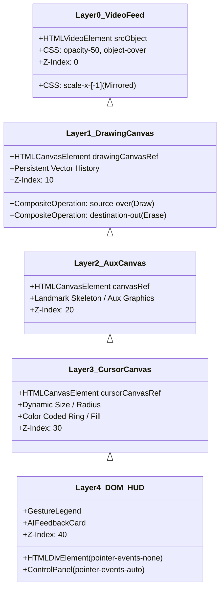
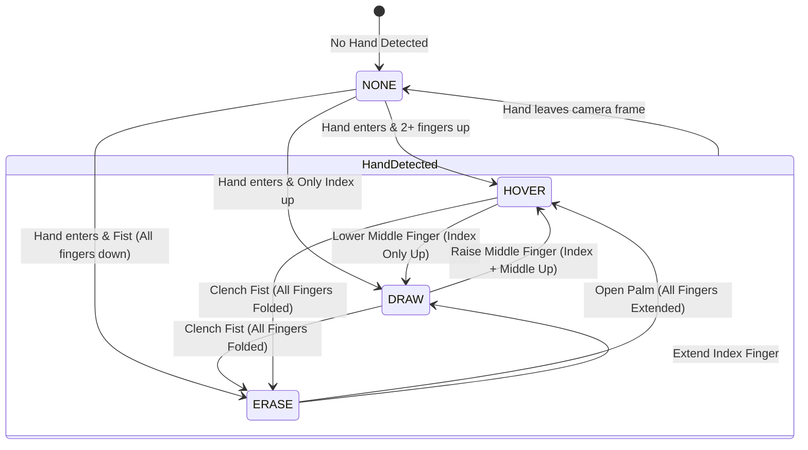
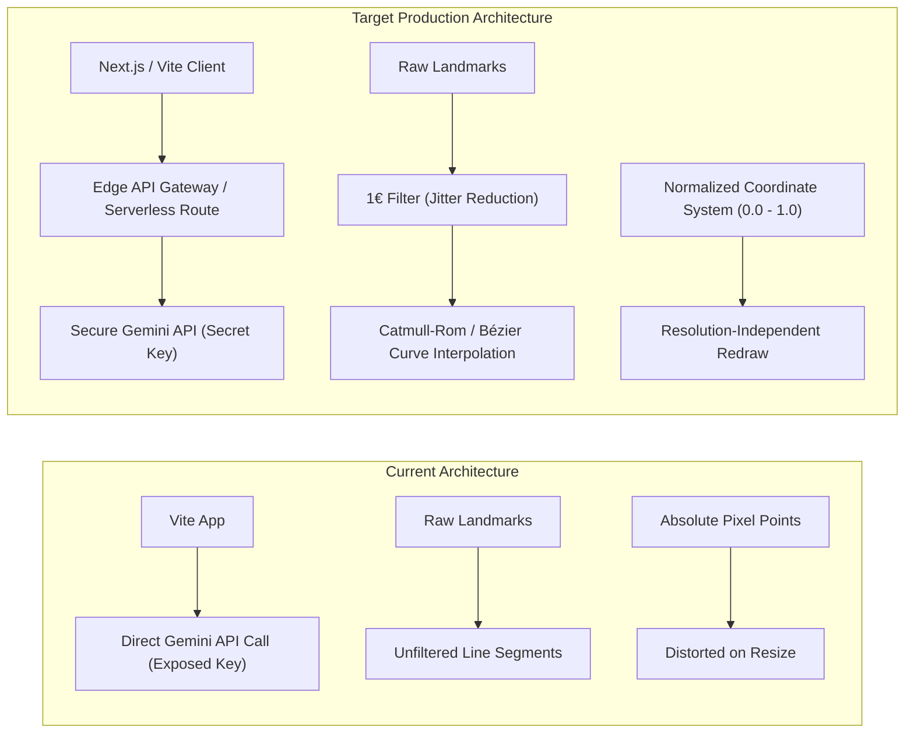

## Run Locally
**Prerequisites:**  Node.js

1. Install dependencies:
   `npm install`
2. Set the `GEMINI_API_KEY` in [.env.local](.env.local) to your Gemini API key
3. Run the app:
   `npm run dev`


# AirDraw AI — System Architecture & Application Design Document

**Document Version:** 1.0.0  
**Target Application:** AirDraw AI (`airdraw-ai`)  
**Technology Stack:** React 19, TypeScript, Vite, HTML5 Multi-Layer Canvas, MediaPipe Hands, Google GenAI SDK (Gemini 3 Flash), Tailwind CSS  
**Repository Source:** [https://github.com/AvijatChahar/Air-Draw.git](https://github.com/AvijatChahar/Air-Draw.git)

---

## 1. Executive Summary & Product Vision

### 1.1 Overview
**AirDraw AI** is a real-time, contactless, browser-native digital whiteboard application. It translates hand movements and gestures captured through an ordinary user webcam into fluid digital canvas strokes without requiring physical touchscreens, stylus pens, or specialized tracking sensors. Furthermore, it integrates multimodal generative AI (Google Gemini) to analyze, interpret, and critique digital sketches on demand.

### 1.2 Core Capabilities
* **Contactless Air Drawing:** Uses index finger tracking to draw freehand strokes with customizable color palettes and brush sizes.
* **Spatial Gesture Recognition:** Real-time classification of hand configurations (Drawing, Hovering/Moving, Erasing) using hand landmark geometry.
* **Composite Canvas Compositing:** Multi-layer canvas architecture separating raw video feed, persistent drawing strokes, and real-time visual cursor indicators.
* **Vector Path History:** In-memory path vectorization supporting non-destructive undo and redo capabilities.
* **Multimodal Generative Vision AI:** Instant visual sketch evaluation and creative critique via Google Gemini (`gemini-3-flash-preview`).
* **Zero Backend Footprint:** Fully client-side execution running computer vision inference locally at up to 60 FPS using MediaPipe WebAssembly.

---

## 2. High-Level System Architecture

AirDraw AI follows a **Client-Side Component-Driven Architecture** with dedicated pipelines for **Computer Vision Inference**, **Graphics Rendering**, and **Cloud Multimodal AI Interaction**.


```mermaid

graph TB
    subgraph Client ["Client Browser Runtime (Vite + React 19)"]
        subgraph Hardware ["Input Devices"]
            Camera["Webcam Hardware (getUserMedia)"]
        end

        subgraph Vision ["Vision & Gesture Subsystem"]
            MPCamera["MediaPipe Camera Utility"]
            MPHands["MediaPipe Hands (Wasm / WebGL)"]
            LandmarkDetector["21 3D Landmark Extractor"]
            GestureClassifier["Geometric Gesture Classifier"]
        end

        subgraph CanvasEngine ["Multi-Canvas Rendering Engine"]
            VideoBg["Layer 0: Mirrored Video Stream Element"]
            DrawCanvas["Layer 1: Persistent Drawing Canvas (source-over / destination-out)"]
            OverlayCanvas["Layer 2: Auxiliary / Landmark Feedback Canvas"]
            CursorCanvas["Layer 3: Dynamic Gesture Cursor Canvas"]
            PathStore["Vector Path Store (History & Redo Stacks)"]
        end

        subgraph UIState ["React Application Layer"]
            AppRoot["App Container (App.tsx)"]
            HUD["Gesture Legend & HUD (GestureLegend.tsx)"]
            Controls["Control Panel Toolbar (ControlPanel.tsx)"]
            EventBus["Window CustomEvent Bus ('undo', 'redo', 'clear', 'capture')"]
        end
    end

    subgraph Cloud ["Google Cloud / Gemini API"]
        GeminiAPI["Gemini 3 Flash Vision Endpoint"]
    end

    Camera -->|Video Frames (1280x720)| MPCamera
    MPCamera -->|Frame Callback| MPHands
    MPHands -->|multiHandLandmarks| LandmarkDetector
    LandmarkDetector -->|Tip / Pip Coordinates| GestureClassifier
    GestureClassifier -->|GestureType (DRAW / HOVER / ERASE)| CanvasEngine
    GestureClassifier -->|Active Gesture Event| AppRoot
    AppRoot --> HUD

    CanvasEngine -->|Vector Points| PathStore
    Controls -->|Trigger Events| EventBus
    EventBus -->|Command Dispatch| CanvasEngine

    Controls -->|Analyze Request| AppRoot
    DrawCanvas -->|toDataURL('image/png')| AppRoot
    AppRoot -->|Base64 Image Payload| GeminiAPI
    GeminiAPI -->|AI Feedback Text| AppRoot
    AppRoot -->|Render AI Card| HUD
```

---

## 3. Technology Stack & Architectural Roles

| Component / Layer | Technology / Library | Architectural Role & Implementation Details |
| :--- | :--- | :--- |
| **UI Framework** | React 19 (`react`, `react-dom`) | Declarative state orchestration, lifecycle management, HUD overlay elements. |
| **Language & Typing** | TypeScript (`~5.8.2`) | Strict typing for vector paths, points, gestures, and canvas context parameters. |
| **Build & Dev Server** | Vite (`^6.2.0`) | Fast HMR, bundler, environment variable injection (`process.env.API_KEY`). |
| **Styling & HUD Design** | Tailwind CSS (CDN) | Modern glassmorphism HUD (`backdrop-blur-xl`, semi-transparent borders, gradients). |
| **Hand Tracking** | MediaPipe Hands (`@mediapipe/hands`) | Client-side 21-landmark 3D hand detection running via WebAssembly/WebGL. |
| **Camera Utilities** | MediaPipe Camera Utils (`@mediapipe/camera_utils`) | RequestAnimationFrame-synchronized camera stream pump to vision pipeline. |
| **Multimodal Vision AI** | Google GenAI SDK (`@google/genai`) | Invokes Gemini 3 Flash with inline Base64 PNG drawings for creative critique. |
| **Rendering Subsystem** | HTML5 2D Canvas Context API | Multi-layered rendering with blend mode compositing (`destination-out`). |

---

## 4. Multi-Layer Canvas Rendering Pipeline

Rendering is structured across four distinct Z-indexed layers to maximize performance, prevent flickering, and isolate high-frequency redraws (cursor at 60 FPS) from static stroke buffers.



### 4.1 Layer Breakdown
1. **Layer 0 — Mirrored Webcam Video Feed (`z-0`):**
   * Renders the mirrored webcam video feed (`scale-x-[-1]`) at 50% opacity.
   * Serves as spatial feedback so users can see their physical hands aligned with the virtual air canvas.
2. **Layer 1 — Persistent Drawing Canvas (`z-10`):**
   * Contains all permanent artwork.
   * Employs standard `source-over` compositing for drawing strokes.
   * Switches to `destination-out` compositing for erasing, mathematically clearing pixels along the eraser path without needing background repainting.
3. **Layer 2 — Skeleton / Feedback Canvas (`z-20`):**
   * Cleared every frame (`clearRect`).
   * Reserved for real-time skeleton overlay, calibration helpers, or landmark debugging.
4. **Layer 3 — Cursor Indicator Canvas (`z-30`):**
   * Cleared every single frame.
   * Draws an interactive targeting reticle that tracks the tip of the index finger (`Landmark 8`).
   * Visual state changes based on gesture:
     * **Draw Mode:** Solid circular reticle colored with current brush color, matching brush radius.
     * **Hover Mode:** Thin ring reticle with 12px radius.
     * **Erase Mode:** Red circular boundary indicator (`#ef4444`) with 20px radius.
5. **Layer 4 — React DOM HUD (`z-40 / absolute inset-0`):**
   * Container set to `pointer-events-none` so cursor and video pass through seamlessly.
   * Interactive UI elements (buttons, sliders, palette) set to `pointer-events-auto`.

---

## 5. Computer Vision & Gesture Recognition Engine

### 5.1 MediaPipe Hand Landmark Topology
MediaPipe Hands provides 21 3D coordinates $(x, y, z)$ normalized to $[0.0, 1.0]$. The system extracts the key landmarks:

```
  [8] Index Tip       [12] Middle Tip      [16] Ring Tip       [20] Pinky Tip
       |                    |                    |                   |
  [7] Index DIP       [11] Middle DIP      [15] Ring DIP       [19] Pinky DIP
       |                    |                    |                   |
  [6] Index PIP       [10] Middle PIP      [14] Ring PIP       [18] Pinky PIP
       |                    |                    |                   |
  [5] Index MCP       [9]  Middle MCP      [13] Ring MCP       [17] Pinky MCP
       \                    |                    /                  /
        \----------------- [0] Wrist -----------/------------------/
```

### 5.2 Coordinate Transformation & Mirroring
Since webcams record from the front, raw horizontal coordinates are inverted relative to user intuition. The application applies coordinate transformation:

$$X_{canvas} = (1 - X_{indexTip}) \times Width_{canvas}$$
$$Y_{canvas} = Y_{indexTip} \times Height_{canvas}$$

### 5.3 Heuristic Finger State Classification
Finger elevation is calculated by comparing fingertip coordinates against proximal interphalangeal (PIP) joint coordinates along the vertical axis (in screen coordinates, $y=0$ is at the top):

* $\text{isIndexUp} \iff Y_8 < Y_6$
* $\text{isMiddleUp} \iff Y_{12} < Y_{10}$
* $\text{isRingUp} \iff Y_{16} < Y_{14}$
* $\text{isPinkyUp} \iff Y_{20} < Y_{18}$

### 5.4 Gesture State Machine



#### Decision Rules Table
| Gesture Type | Landmark Condition | Physical Hand Pose | Action Taken |
| :--- | :--- | :--- | :--- |
| **`DRAW`** | `isIndexUp && !isMiddleUp` | Index finger pointing up, all other fingers curled | Appends points to active path, renders continuous stroke to Layer 1. |
| **`HOVER`** | `(isIndexUp && isMiddleUp) \|\| (all 4 up)` | Peace sign (V-sign) or open palm | Commits active path to history, moves cursor without leaving ink. |
| **`ERASE`** | `!isIndexUp && !isMiddleUp && !isRingUp && !isPinkyUp` | Closed fist | Performs `destination-out` composite drawing with large radius (40px). |
| **`NONE`** | `results.multiHandLandmarks.length === 0` | Hand absent or tracking lost | Commits pending path, hides cursor reticle. |

---

## 6. Data Models & State Management

### 6.1 Core Type Definitions (`types.ts`)
```typescript
export enum GestureType {
  NONE = 'NONE',
  DRAW = 'DRAW',
  HOVER = 'HOVER',
  ERASE = 'ERASE'
}

export enum PathType {
  DRAW = 'DRAW',
  ERASE = 'ERASE'
}

export interface Point {
  x: number;
  y: number;
}

export interface Path {
  points: Point[];
  color: string;
  size: number;
  type: PathType;
}

export interface DrawingConfig {
  color: string;
  brushSize: number;
}
```

### 6.2 State Management Architecture
The application adopts a **hybrid state model**:
1. **High-Frequency Graphics State (`useRef`):**
   * `paths.current`: Stack of completed `Path` vector objects.
   * `redoStack.current`: Stack of undone `Path` objects.
   * `currentPath.current`: Active drawing path accumulating points during an ongoing stroke.
   * `lastPoint.current`: Previous point coordinates for smooth line segment interpolation (`lineTo`).
   * *Rationale:* Bypasses React reconciliation cycles to guarantee 60 FPS drawing with zero lag.
2. **Low-Frequency UI State (`useState`):**
   * `config`: `{ color, brushSize }`
   * `currentGesture`: Active gesture passed to `GestureLegend` for real-time visual feedback.
   * `isAiAnalyzing`: Boolean toggle for AI spinner and button disable state.
   * `aiFeedback`: Gemini generated critique string or null.
3. **Decoupled Event Bus (`window.dispatchEvent`):**
   * Decouples the React `ControlPanel` from direct canvas references using standard DOM CustomEvents:
     * `'clear-canvas'` $\rightarrow$ Clears canvas, empties `paths` & `redoStack`.
     * `'request-capture'` $\rightarrow$ Triggers `toDataURL('image/png')` export and fires callback.
     * `'undo-canvas'` $\rightarrow$ Pops from `paths`, pushes to `redoStack`, triggers `redrawAll()`.
     * `'redo-canvas'` $\rightarrow$ Pops from `redoStack`, pushes to `paths`, triggers `redrawAll()`.

---

## 7. Multimodal AI Integration (Gemini 3 Flash)

AirDraw AI embeds Google's multimodal LLM via the official `@google/genai` SDK to evaluate the user's air-canvas sketch.

```mermaid
sequenceDiagram
    autonumber
    actor User
    participant CP as ControlPanel
    participant App as App.tsx
    participant Canvas as AirCanvas (DrawingCanvas)
    participant Gemini as Gemini 3 Flash API

    User->>CP: Clicks "AI Critique" Button
    CP->>window: dispatchEvent('request-capture')
    window->>Canvas: Event Listener: handleCapture()
    Canvas->>Canvas: drawingCanvas.toDataURL('image/png')
    Canvas->>App: onCapture(imageDataUrl)
    App->>App: Set isAiAnalyzing = true
    App->>App: Strip Base64 prefix ("data:image/png;base64,")
    App->>Gemini: ai.models.generateContent({ model: 'gemini-3-flash-preview', contents: [...] })
    Note over App,Gemini: Payload: Text prompt + inlineData (PNG Base64)
    Gemini-->>App: response.text (Creative Critique)
    App->>App: Set aiFeedback & isAiAnalyzing = false
    App->>User: Displays Glassmorphism Critique Card
```

### 7.1 AI Prompt Design & Parameters
* **Model:** `gemini-3-flash-preview`
* **MIME Type:** `image/png`
* **System Prompt:**
  ```text
  "Look at this digital drawing created using hand gestures. What do you see? Provide a creative, one-sentence interpretation or critique."
  ```
* **Error Resilience:** In case of network errors or quota limits, catches exception gracefully and renders fallback UI message: `"The AI is shy right now. Keep drawing!"`.

---

## 8. End-to-End System Workflows

### 8.1 Continuous Air Drawing Frame Loop
```mermaid
sequenceDiagram
    autonumber
    participant Webcam as Webcam Hardware
    participant CameraUtil as MediaPipe Camera
    participant Hands as MediaPipe Hands
    participant AirCanvas as AirCanvas Logic
    participant Ctx as CanvasRenderingContext2D

    loop Every Animation Frame (~60 FPS)
        Webcam->>CameraUtil: New Frame Available
        CameraUtil->>Hands: hands.send({ image: videoElement })
        Hands->>AirCanvas: onResults(results)
        AirCanvas->>AirCanvas: Compute Fingertip Landmarks (8, 6, 12, 10, etc.)
        AirCanvas->>AirCanvas: Transform Coordinates: x = (1 - xNorm) * W, y = yNorm * H
        AirCanvas->>AirCanvas: Evaluate Gesture (DRAW / HOVER / ERASE / NONE)
        alt Gesture == DRAW
            AirCanvas->>Ctx: ctx.beginPath(); ctx.moveTo(last); ctx.lineTo(curr); ctx.stroke();
            AirCanvas->>AirCanvas: currentPath.points.push({x, y})
        else Gesture == ERASE
            AirCanvas->>Ctx: ctx.globalCompositeOperation = 'destination-out'
            AirCanvas->>Ctx: ctx.lineWidth = 40; ctx.stroke()
        else Gesture == HOVER
            AirCanvas->>AirCanvas: Commit currentPath to paths history
        end
        AirCanvas->>Ctx: Render dynamic cursor reticle on Layer 3
        AirCanvas->>AirCanvas: Notify App of Gesture state change
    end
```

---

## 9. Component Breakdown & Source File Mapping

```
Air-Draw/
├── index.html                 # HTML shell, CDN script tags (Tailwind, MediaPipe), importmap
├── index.tsx                  # Application bootstrap into #root
├── App.tsx                    # Root container, AI API integration, HUD layout
├── types.ts                   # Core TypeScript domain models (GestureType, Path, Point)
├── vite.config.ts             # Vite configuration, environment variable defines, server options
├── metadata.json              # Frame permissions specification ("camera")
├── package.json               # Dependencies & build scripts
└── components/
    ├── AirCanvas.tsx          # Multi-layer canvas, MediaPipe camera loop, vector renderer
    ├── ControlPanel.tsx       # Floating toolbar (Undo/Redo, Color Palette, Brush Slider, AI)
    └── GestureLegend.tsx      # Real-time gesture status HUD cards
```

### 9.1 Component Specifications

#### `App.tsx`
* **Role:** State coordinator and layout orchestrator.
* **Responsibilities:**
  * Stores `DrawingConfig` (color, brush size).
  * Stores `currentGesture` detected by `AirCanvas`.
  * Manages AI communication lifecycle (`analyzeDrawing`, `isAiAnalyzing`, `aiFeedback`).
  * Assembles `AirCanvas`, `GestureLegend`, and `ControlPanel` in a responsive HUD viewport.

#### `AirCanvas.tsx`
* **Role:** High-performance graphics and computer vision controller.
* **Responsibilities:**
  * Mounts 3 stacked `<canvas>` elements and 1 background `<video>` element.
  * Boots MediaPipe Hands model (`locateFile`, `minDetectionConfidence: 0.7`, `modelComplexity: 1`).
  * Binds camera loop using `Camera` utility.
  * Executes vector path storage and canvas redrawing for undo/redo.
  * Handles dynamic window resizing without clearing drawing history.

#### `ControlPanel.tsx`
* **Role:** Floating interactive HUD toolbar.
* **Responsibilities:**
  * Preset color swatches + HTML5 native color picker input.
  * Brush size slider (1px to 50px) with live numeric readout.
  * Undo / Redo buttons dispatching custom DOM events.
  * Clear canvas trigger.
  * "AI Critique" trigger with animated SVG loading state.

#### `GestureLegend.tsx`
* **Role:** Spatial gesture guidance and live feedback panel.
* **Responsibilities:**
  * Visual dictionary displaying supported gestures:
    * ☝️ **Draw:** Index Finger Up
    * ✌️ **Move:** Index + Middle Up
    * ✊ **Erase:** Closed Fist
  * Automatically highlights the active gesture with glow effects and badge scaling.

---

## 10. Architectural Deficiencies & Security Vulnerabilities

Through comprehensive source analysis, several critical technical limitations and design liabilities were identified:

### 10.1 Security Vulnerabilities
1. **Client-Side Gemini API Key Exposure:**
   * In `App.tsx` line 27:
     ```typescript
     const ai = new GoogleGenAI({ apiKey: process.env.API_KEY });
     ```
   * And in `vite.config.ts` line 14:
     ```typescript
     'process.env.API_KEY': JSON.stringify(env.GEMINI_API_KEY)
     ```
   * *Risk:* The Gemini API key is embedded directly into client-side JavaScript bundles, exposing the private key to anyone inspecting browser network requests or bundle sources.

### 10.2 Architectural & Performance Limitations
2. **Absolute Screen-Space Coordinate Storage:**
   * Strokes are recorded in absolute pixel values (`x`, `y`).
   * When the browser window is resized, `redrawAll()` redraws original absolute pixel coordinates on a canvas with new dimensions, resulting in clipped or displaced drawings.
3. **Global `CustomEvent` Event Bus Fragility:**
   * Components communicate via `window.dispatchEvent(new CustomEvent('...'))` instead of React callbacks, context, or standard `forwardRef` / `useImperativeHandle`.
   * *Risk:* Hard to test in isolation, bypasses React component tree isolation, and susceptible to naming collisions.
4. **Hybrid CDN / Bundler Dependency Splitting:**
   * `index.html` loads MediaPipe scripts via CDN `<script>` tags, Tailwind via CDN, and ESM dependencies via `importmap`, while `package.json` simultaneously defines Vite and npm dependencies.
   * *Risk:* Offline execution failures, lack of bundle caching, potential version mismatches between npm types and runtime CDN scripts.
5. **Absence of Jitter Filtering & Smoothing:**
   * MediaPipe raw landmark outputs inherently suffer from microscopic frame-to-frame sensor noise/jitter.
   * Strokes currently connect raw landmark points with simple straight lines (`lineTo`), producing slight jaggedness at low drawing speeds.

---

## 11. Production Evolution & Recommended Roadmap

To transition AirDraw AI from a prototype to a production-grade enterprise application, the following architectural upgrades are recommended:



### 11.1 Proposed Enhancements
1. **Secure Backend Proxy / Serverless Route:**
   * Implement an edge route (e.g. `/api/critique`) to receive image payloads from the client and invoke the Gemini SDK using a server-side environment variable.
2. **Normalized Resolution-Independent Vector Paths:**
   * Store points normalized to $[0.0, 1.0]$:
     ```typescript
     interface NormalizedPoint { nx: number; ny: number; }
     ```
   * Scale coordinates dynamically during rendering: $X = nx \times Width$, $Y = ny \times Height$.
3. **Stroke Smoothing via 1€ Filter & Bézier Curves:**
   * Introduce a **One-Euro Filter** (adaptive low-pass filter) to eliminate webcam landmark jitter without adding perceptual lag.
   * Interpolate stroke segments using quadratic Bézier curves (`quadraticCurveTo`) rather than raw straight line segments.
4. **Export & Sharing Capabilities:**
   * Add high-resolution PNG, SVG vector export, and WebP snapshot saving.
5. **Multi-Hand & Advanced Gesture Support:**
   * Support two-handed interaction (e.g., non-dominant hand selects colors/tools while dominant hand draws).
   * Pinch-to-zoom and two-finger pan for infinite canvas navigation.

---

## 12. Conclusion

AirDraw AI demonstrates an elegant fusion of **client-side Computer Vision (MediaPipe)**, **high-performance multi-layer 2D Canvas compositing**, and **Multimodal Generative AI (Google Gemini)** in a lightweight browser application. Its modular separation of concern between video capture, vision heuristic classification, and canvas compositing provides an excellent foundation that can be easily scaled into a production-grade creative tool.
