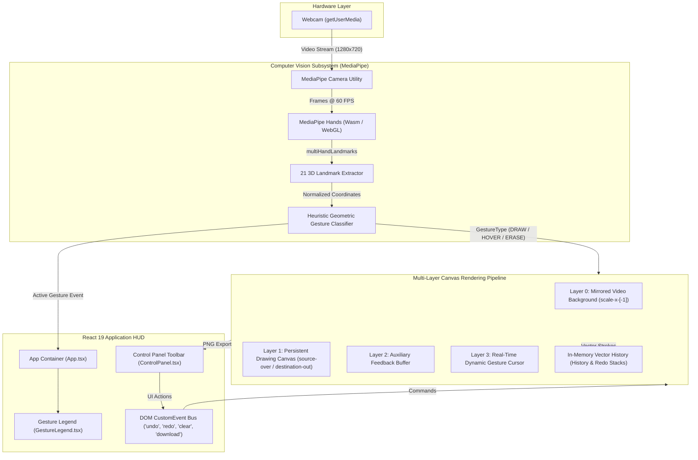
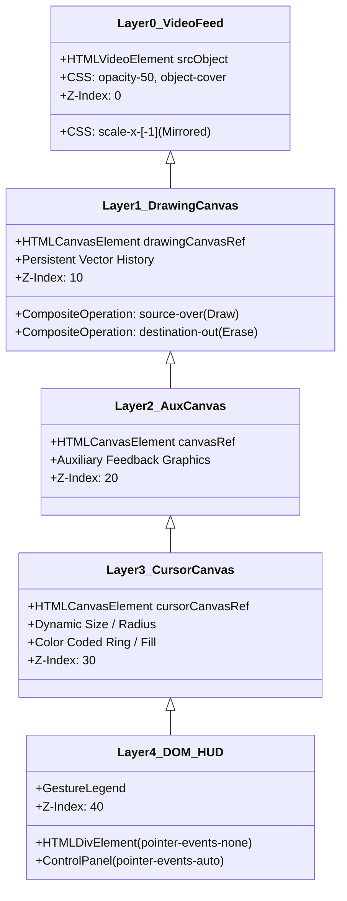
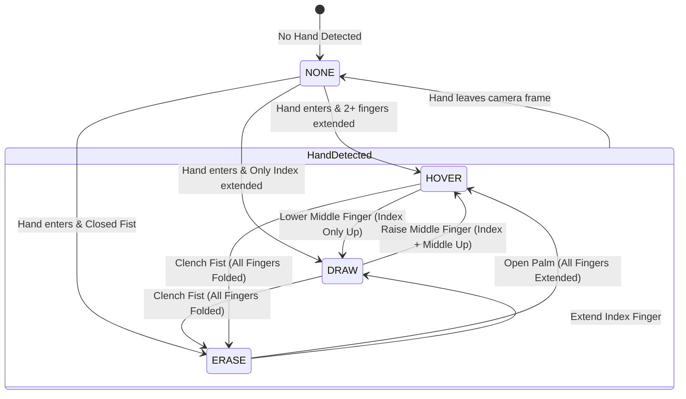
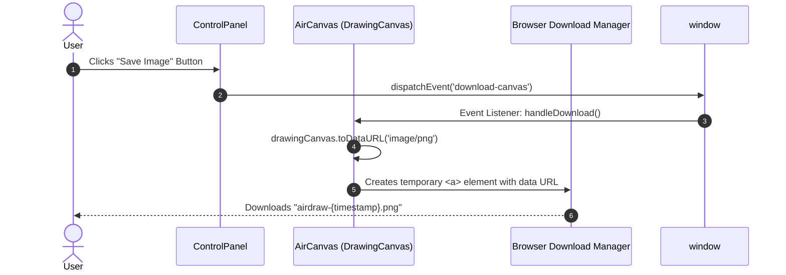

# AirDraw — Real-Time Hand Gesture Whiteboard

**AirDraw** is a high-performance, contactless, browser-native digital drawing application. It translates hand movements and gestures captured through an ordinary user webcam into fluid digital canvas strokes without requiring physical touchscreens, stylus pens, or specialized tracking sensors.

The application runs **100% client-side** using WebAssembly and WebGL via MediaPipe Hands, with zero backend requirements and no API keys needed.

---

## Quick Start

### Prerequisites
* [Node.js](https://nodejs.org/) (v18+)
* A working webcam

### Run Locally
```bash
# 1. Install dependencies
npm install

# 2. Start the local development server
npm run dev
```

Open [http://localhost:3000/](http://localhost:3000/) in your browser and grant webcam permissions when prompted.

---

## Gesture Controls

| Gesture | Pose | Action | Visual Reticle |
| :--- | :--- | :--- | :--- |
| **Draw** (☝️) | **Index Finger Up** (all other fingers curled) | Paints continuous strokes on the canvas using active color & brush size | Solid circle with active brush color |
| **Move / Hover** (✌️) | **Index + Middle Fingers Up** (or Open Palm) | Moves the cursor across the canvas without leaving any strokes | Thin neutral ring reticle |
| **Erase** (✊) | **Closed Fist** (all fingers curled) | Erases strokes using `destination-out` compositing (40px radius) | Red circular eraser reticle |

### Keyboard Shortcuts
* **`C`** or **`Delete`**: Clear Screen
* **`Ctrl + Z`** / **`Cmd + Z`**: Undo last stroke
* **`Ctrl + Y`** / **`Cmd + Y`** (or `Ctrl + Shift + Z`): Redo stroke

---

## System Architecture

AirDraw is built on a **Client-Side Component-Driven Architecture** combining real-time computer vision inference with a multi-layered HTML5 Canvas rendering pipeline.



---

## Technology Stack

| Layer | Technology | Role & Implementation |
| :--- | :--- | :--- |
| **UI Framework** | React 19 (`react`, `react-dom`) | Declarative state management, HUD overlay elements, lifecycle handling |
| **Language & Typing** | TypeScript (`~5.8.2`) | Strict typing for vector paths, points, gestures, and canvas context parameters |
| **Build & Tooling** | Vite (`^6.2.0`) | Lightning-fast HMR and bundling |
| **Computer Vision** | MediaPipe Hands (`@mediapipe/hands`) | Local 21-landmark 3D hand detection running via WebAssembly/WebGL |
| **Camera Feed** | MediaPipe Camera Utils (`@mediapipe/camera_utils`) | RequestAnimationFrame-synchronized camera stream pump |
| **Rendering Subsystem** | HTML5 2D Canvas Context API | Multi-layered rendering with blend mode compositing (`destination-out`) |
| **Styling** | Tailwind CSS (CDN) | Modern glassmorphism HUD (`backdrop-blur-xl`, semi-transparent borders) |

---

## Multi-Layer Canvas Rendering Pipeline

Rendering is partitioned across four Z-indexed layers to maximize performance, prevent flickering, and decouple high-frequency cursor rendering (60 FPS) from static stroke buffers:



### Layer Responsibilities
1. **Layer 0 — Mirrored Video Feed (`z-0`):** Mirrored webcam stream (`scale-x-[-1]`) at 50% opacity, providing visual feedback aligned with physical hand motion.
2. **Layer 1 — Persistent Drawing Canvas (`z-10`):** Permanent artwork buffer. Employs `source-over` for drawing and `destination-out` for non-destructive erasing.
3. **Layer 2 — Auxiliary Canvas (`z-20`):** Cleared every frame; available for auxiliary graphics or landmark overlays.
4. **Layer 3 — Cursor Canvas (`z-30`):** Cleared and updated every frame. Renders an interactive targeting reticle following the index fingertip (`Landmark 8`).
5. **Layer 4 — DOM HUD (`z-40`):** Floating glassmorphism toolbar and gesture legend with `pointer-events-auto` on controls while allowing canvas passthrough.

---

## Computer Vision & Gesture Classification

### Landmark Geometry
MediaPipe Hands provides 21 3D coordinates $(x, y, z)$ normalized to $[0.0, 1.0]$. Key tracking landmarks:

* **Index Finger:** Tip (`8`), DIP (`7`), PIP (`6`), MCP (`5`)
* **Middle Finger:** Tip (`12`), DIP (`11`), PIP (`10`), MCP (`9`)
* **Ring Finger:** Tip (`16`), DIP (`15`), PIP (`14`), MCP (`13`)
* **Pinky Finger:** Tip (`20`), DIP (`19`), PIP (`18`), MCP (`17`)

### Coordinate Transformation & Mirroring
Webcam images are flipped horizontally to provide an intuitive mirror experience:

$$X_{canvas} = (1 - X_{indexTip}) \times Width_{canvas}$$
$$Y_{canvas} = Y_{indexTip} \times Height_{canvas}$$

### Finger Elevation Heuristics
A finger is extended if its fingertip $Y$ is above its proximal interphalangeal (PIP) joint ($y=0$ is at the top of the screen):

* $\text{isIndexUp} \iff Y_8 < Y_6$
* $\text{isMiddleUp} \iff Y_{12} < Y_{10}$
* $\text{isRingUp} \iff Y_{16} < Y_{14}$
* $\text{isPinkyUp} \iff Y_{20} < Y_{18}$



---

## Data Structures & State Management

### Domain Models (`types.ts`)
```typescript
export enum GestureType {
  NONE = 'NONE',
  DRAW = 'DRAW',
  HOVER = 'HOVER',
  ERASE = 'ERASE'
}

export enum PathType {
  DRAW = 'DRAW',
  ERASE = 'ERASE'
}

export interface Point {
  x: number;
  y: number;
}

export interface Path {
  points: Point[];
  color: string;
  size: number;
  type: PathType;
}

export interface DrawingConfig {
  color: string;
  brushSize: number;
}
```

### Hybrid State Architecture
1. **High-Frequency Graphics State (`useRef`):**
   * `paths.current`: Stack of completed `Path` vector objects.
   * `redoStack.current`: Stack of undone `Path` objects.
   * `currentPath.current`: Active drawing path accumulating points.
   * `lastPoint.current`: Previous point for smooth interpolation (`lineTo`).
   * *Bypasses React reconciliation cycles to ensure 60 FPS drawing.*
2. **Low-Frequency UI State (`useState`):**
   * `config`: `{ color, brushSize }`
   * `currentGesture`: Active gesture passed to `GestureLegend`.
3. **Decoupled DOM Event Bus (`window.dispatchEvent`):**
   * `'clear-canvas'`: Clears canvas and empties stroke/redo buffers.
   * `'download-canvas'`: Exports drawing canvas as a `.png` file.
   * `'undo-canvas'`: Pops last path to redo stack and redraws.
   * `'redo-canvas'`: Restores from redo stack and redraws.

---

## Local Image Export Pipeline



---

## Project Structure

```
Air-Draw/
├── index.html                 # HTML shell, CDN script tags (Tailwind, MediaPipe)
├── index.tsx                  # Application bootstrap into #root
├── App.tsx                    # Root layout, gesture state coordinator
├── types.ts                   # Core domain types (GestureType, Path, Point)
├── vite.config.ts             # Vite configuration and path aliases
├── metadata.json              # Frame permissions ("camera")
├── package.json               # Dependencies and build scripts
└── components/
    ├── AirCanvas.tsx          # Multi-layer canvas, MediaPipe camera loop, vector renderer
    ├── ControlPanel.tsx       # Floating toolbar (Undo/Redo, Palette, Brush Slider, Clear, Save)
    └── GestureLegend.tsx      # Real-time gesture status HUD cards
```

---

## License

MIT
